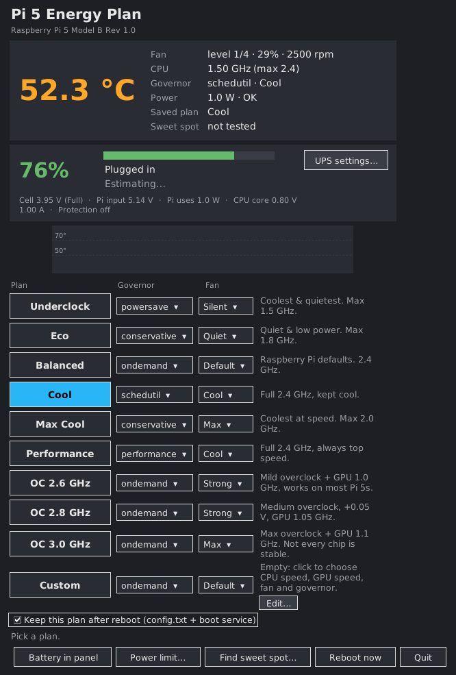
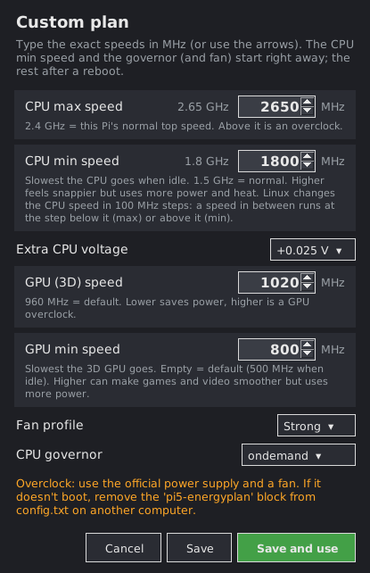
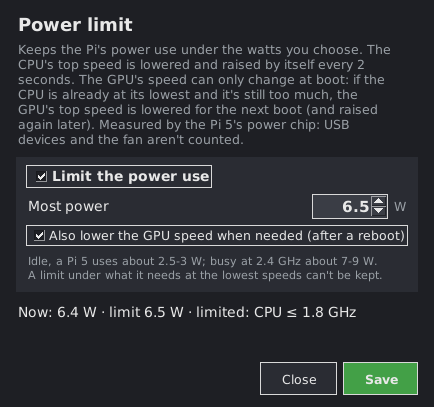
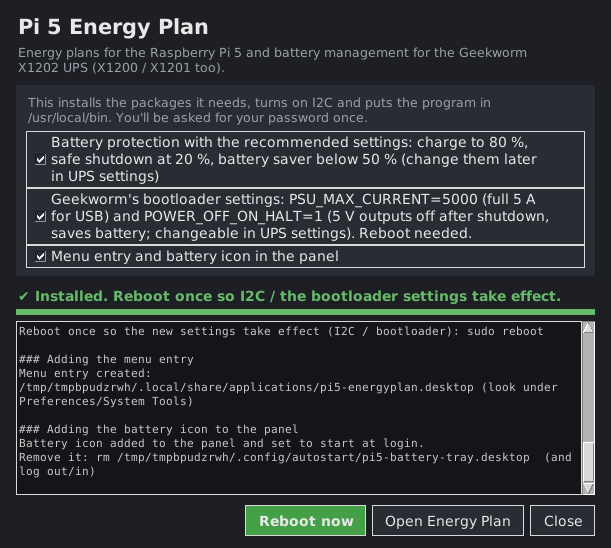
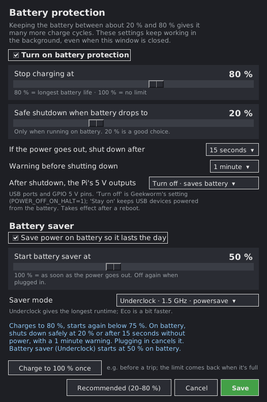
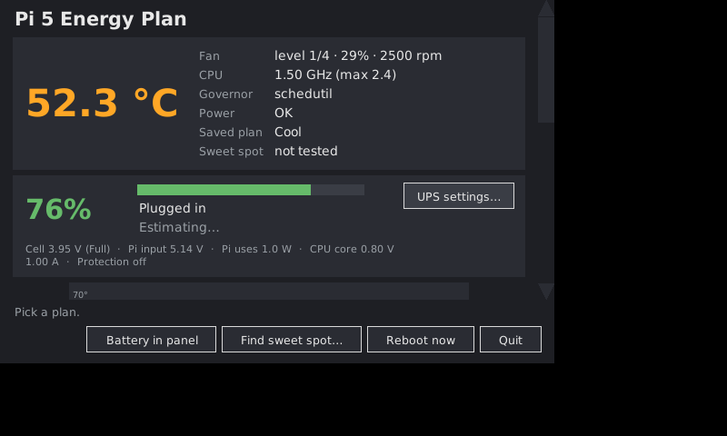

# Pi 5 Energy Plan

`pi5_energyplan.py` is a single Python script for a **Raspberry Pi 5** with the
**Active Cooler** and a **Geekworm X1202** UPS HAT (the X1200 and X1201 work too).
It gives you:

* **One-click energy plans**: CPU governor, maximum CPU speed and fan curve together,
  from "Underclock" (cool and silent) to "OC 3.0 GHz".
* **A UPS / battery manager for the X1202**: battery %, time left or time to full,
  a charge limit (for example stop at 80 %), safe shutdown on low battery or after a
  power cut, and a "battery saver" that slows the Pi down while it runs on battery.
* **A battery icon in the taskbar** (the panel), with % and charging state.
* **A "sweet spot" overclock test**: it finds the fastest overclock your own chip
  runs stably, using one-time test boots so a bad setting can't stop the Pi from booting.

It has a desktop window (GUI) and a full command line, so it also works over SSH.
It also does everything Geekworm's example scripts for the X120x do (`bat.py`,
`pld.py`, `merged.py`, `qtx120x.py` and their Trixie versions), without their bugs:
see [Geekworm's scripts: what's included](#geekworms-scripts-whats-included-and-what-was-fixed).

**Install without a terminal:** download the ZIP, double-click
**Install Pi 5 Energy Plan**. See [Installation](#4-installation).

### Other Raspberry Pi models, and without the UPS

It detects the board and only offers what that board has:

| Board | Plans (top speed) | Overclock plans | Fan curves | GPU clock | UPS features, sweet spot test |
|---|---|---|---|---|---|
| Pi 5, 500, CM5 | 1.5–2.4 GHz | 2.6 / 2.8 / 3.0 GHz | yes (fan connector) | yes | yes |
| Pi 4 Rev 1.4+, 400 | 1.1–1.8 GHz | 2.0 GHz (`over_voltage=6`) | – | – | – |
| Pi 4 older revisions, CM4 | 0.9–1.5 GHz | 1.8 GHz (`over_voltage=2`), 2.0 GHz | – | – | – |
| Pi 3B+ / 3A+ / 3B | up to 1.4 / 1.2 GHz | none | – | – | – |
| Zero 2 W | 0.6–1.0 GHz | none | – | – | – |
| Zero, Zero W | 0.7–1.0 GHz | none | – | – | – |

* Plans are worked out from the board's own top speed (Underclock ≈ 62 %, Eco 75 %,
  Max Cool 83 %), never below its lowest speed. The Custom plan's range follows the
  board too: no overclock on Pi 3 / Zero, which throttle without cooling.
* The `config.txt` block goes under the board's own section (`[pi5]`, `[pi4]`,
  `[pi3]`, `[pi02]`, `[pi0]`). If the SD card is moved to another model, it isn't used
  there: that Pi starts with its defaults (and Performance), not with another
  board's overclock.
* **Without the X1202** (or on any other board): no battery card, panel icon, UPS
  settings or bootloader settings (`PSU_MAX_CURRENT=5000` would be wrong on a normal
  3 A supply), and the battery guard never touches GPIO 6 / 16 or shuts down for UPS
  reasons. On a Pi 5 the window says why no UPS was found (for example "I2C is off").



---

## Contents

1. [What it does on the Raspberry Pi 5](#1-what-it-does-on-the-raspberry-pi-5)
2. [What it does with the Geekworm X1202](#2-what-it-does-with-the-geekworm-x1202)
3. [Sweet spot overclock test](#3-sweet-spot-overclock-test)
4. [Installation](#4-installation)
5. [Using it](#5-using-it)
6. [Files it creates](#6-files-it-creates)
7. [Updating and uninstalling](#7-updating-and-uninstalling)
8. [Nothing is ever added twice](#8-nothing-is-ever-added-twice)
9. [Troubleshooting](#9-troubleshooting)
10. [Testing](#testing)

---

## 1. What it does on the Raspberry Pi 5

### The plans

| Plan | CPU governor | Max CPU | Fan profile | Notes |
|---|---|---|---|---|
| Underclock | powersave | 1.5 GHz | Silent | Coolest and quietest |
| Eco | conservative | 1.8 GHz | Quiet | Quiet, low power |
| Balanced | ondemand | 2.4 GHz | Default | Same as Raspberry Pi OS defaults |
| Cool | schedutil | 2.4 GHz | Cool | Full speed, kept cool |
| Max Cool | conservative | 2.0 GHz | Max | Coolest while still fairly fast |
| Performance | performance | 2.4 GHz | Cool | Always at top speed |
| OC 2.6 GHz | ondemand | 2.6 GHz, +0.025 V, GPU 1.0 GHz | Strong | Mild overclock, slight GPU overclock |
| OC 2.8 GHz | ondemand | 2.8 GHz, +0.05 V, GPU 1.05 GHz | Strong | Medium overclock |
| OC 3.0 GHz | ondemand | 3.0 GHz, +0.05 V, GPU 1.1 GHz | Max | Not every chip is stable |
| Sweet Spot | ondemand | found by the test | Strong | Only appears after the [test](#3-sweet-spot-overclock-test) |
| **Custom** | your choice | your choice | your choice | Empty until you fill it in: see [Your own plan](#your-own-plan-custom) |

### Your own plan (Custom)

The last row, **Custom**, starts empty. Click it (or its **Edit…** button) and choose.
The speeds are boxes: type the exact number of MHz, or use the arrows.

| Setting | Range |
|---|---|
| CPU max speed | 100–3000 MHz, any number (2400 MHz is the Pi 5's normal top speed; above it is an overclock) |
| CPU min speed | 100 MHz up to the max speed (1500 MHz = normal). The slowest the CPU goes when idle: higher feels snappier but uses more power and heat. Applies right away, and the boot service sets it again at every boot |
| Extra CPU voltage | None, +0.025 V or +0.05 V (2.8 GHz and more usually need it) |
| GPU (3D) speed | 100–1100 MHz, any number (960 MHz = default, which writes nothing) |
| GPU min speed | Empty = default (500 MHz when idle, writes nothing), or 100 MHz up to the GPU speed (`v3d_freq_min` in `config.txt`, applies after a reboot) |
| Fan profile | Silent, Quiet, Default, Cool, Strong, Max |
| CPU governor | powersave, conservative, ondemand, schedutil, performance |

**Save** keeps it for later; **Save and use** applies it right away, like any other plan
(with the overclock warning when it's an overclock). Changing it while it's the plan in
use applies the new values again. From the terminal:

```bash
sudo pi5_energyplan.py --set-custom '{"max_freq_mhz": 2600, "over_voltage_delta": 25000,
  "v3d_freq": 1000, "fan_profile": "Strong", "governor": "ondemand"}' --apply Custom
```

The lowest speeds are optional: add `"min_freq_mhz": 1800` (CPU) and `"v3d_freq_min": 800`
(GPU); leave them out for the normal lowest speeds. Any other plan, and the battery saver,
go back to the normal lowest speed.

* **Exact speeds:** Linux changes the CPU's speed in 100 MHz steps, so a speed in between
  runs at the step below it for the max (2650 → 2600 MHz while running) and the step above
  it for the min (1750 → 1800 MHz). The GPU uses the exact number.
* **Below the normal lowest speed** (CPU 1500 MHz, GPU 500 MHz on a Pi 5): the
  firmware's own minimum is lowered too (`arm_freq_min`, `v3d_freq_min` in `config.txt`),
  so it applies after a reboot. Raspberry Pi doesn't officially support this, and it
  saves little power; if the firmware ignores it, the Pi simply runs at its normal lowest
  speed. The window shows a warning.



**GPU overclock:** the overclock plans also raise the 3D GPU (`v3d_freq`) step by step
from the Pi 5's default of 960 MHz. Only the 3D block is raised, as the Raspberry Pi
documentation recommends: `gpu_freq` would also overclock the core, ISP and video
clocks, and `gpu_freq=1000` at 3.0 GHz is known to freeze some Pi 5s. `--status` and
`--monitor` show the GPU clock. The sweet spot test only tests the CPU, so the "Sweet
Spot" plan leaves the GPU at its default.

The window lets you change each plan's **governor** and **fan profile**. These choices
are saved in `/etc/pi5-energyplan/`. You can also edit the `PLANS` and `FAN_PROFILES`
tables at the top of the script.

Fan profiles set the Active Cooler's 4 steps as *(start temperature, hysteresis,
speed)*:

| Profile | Fan starts at | Full speed at |
|---|---|---|
| Silent | 60 °C | 80 °C |
| Quiet | 55 °C | 78 °C |
| Default | 50 °C | 75 °C (the Pi 5's own default) |
| Cool | 40 °C | 65 °C |
| Strong | 35 °C | 60 °C |
| Max | 30 °C | 55 °C |

### What changes when you pick a plan

| When | What | How |
|---|---|---|
| **Right away** | CPU governor and max frequency | writes `/sys/devices/system/cpu/cpufreq/policy*/scaling_governor` and `scaling_max_freq` |
| **Right away** (if the kernel allows it) | Fan start temperatures | writes the active trip points in `/sys/class/thermal/thermal_zone0` |
| **After a reboot** | Full fan curve (temperatures **and** speeds), `arm_freq`, `over_voltage_delta`, `gpu_freq` | a managed block at the end of `/boot/firmware/config.txt` |
| **At every boot** | Governor and max frequency again. The Raspberry Pi kernel always starts in `powersave` (1.5 GHz); with no saved plan, **Performance** is used instead. If the battery saver is on (on battery), it's left on. | `pi5-energyplan.service`, installed with the program |

The block in `config.txt` looks like this on a Pi 5. The script only ever changes the
text between the two markers:

```ini
# >>> pi5-energyplan (managed by pi5_energyplan.py) >>>
# plan: Cool
[pi5]
dtparam=fan_temp0=40000
dtparam=fan_temp0_hyst=3000
dtparam=fan_temp0_speed=100
...
arm_freq=2400
[all]
# <<< pi5-energyplan <<<
```

`[pi5]` makes it apply only to this model; the `[all]` at the end makes anything added
after the block apply to every model again.

Safety details:

* The first time it edits `config.txt`, it saves the original as
  `config.txt.energyplan.bak`.
* Other `arm_freq`, `over_voltage`, `gpu_freq`, `v3d_freq` or `dtparam=fan_temp…`
  lines in `[all]` or this board's section are commented out with
  `#energyplan-disabled#` so they can't override the plan. Lines for other models'
  sections are left alone.
* Running the same plan again never adds a second block.
* Speeds above what the current boot allows (for example 2.8 GHz when the Pi booted
  at 2.4 GHz) are noted as "unlocks after reboot".

### Power limit (Pi 5)

**Power limit…** (in the window), or `sudo pi5_energyplan.py --power-limit 6`, keeps the
Pi's power use under the watts you choose (2–30 W). It's measured by the Pi 5's power chip
(`vcgencmd pmic_read_adc`, the sum of every supply rail of the board); USB devices and the
fan aren't counted. A small service (`pi5-power-limit.service`) checks it every 2 seconds:

* **CPU, right away:** over the limit, the CPU's top speed goes down one 100 MHz step (two
  when more than 1.5 W over). It measures how many watts one step makes, and goes back up a
  step when that still fits under the limit, after three readings with room. It never goes
  above the plan's own top speed, and a min speed above the limit's speed is lowered with
  it. When a plan or the battery saver changes the speed, the limit takes over again
  within 2 seconds.
* **GPU, after a reboot:** Linux can't change the 3D GPU's speed while the Pi runs; only
  `config.txt` can (`v3d_freq`). So if the Pi stays over the limit for a minute with the
  CPU already at its lowest speed, the GPU's top speed is lowered 100 MHz for the next
  boot. After 30 minutes at least 1.5 W under the limit (CPU not limited) it goes back up
  100 MHz. At most one GPU change per boot, never below 500 MHz (the GPU's normal lowest
  speed), and only with a plan kept after reboot (it lives in the plan's block). Untick
  **Also lower the GPU speed** (`'{"watts": 6, "gpu": false}'`) to leave the GPU alone.
* **Off** (`--power-limit off`, or untick it in the window): the service is removed, the
  plan's own speeds come back right away, and the GPU's after a reboot.

Idle, a Pi 5 uses about 2.5–3 W, and about 7–9 W busy at 2.4 GHz. A limit under what it
needs at the lowest speeds can't be kept; the window and `--status` say so. The stats card
shows the power use (orange when the limit is holding the CPU back), and `--status` has a
**Power limit** line.



### Live status

The window and `--status` show the CPU temperature (with a 4.5-minute graph in the
window), fan level, PWM and RPM, CPU speed, GPU clock, power warnings from
`vcgencmd get_throttled` (under-voltage, throttling), the saved plan, and the
governor **with who set it**: for example `performance (Performance, set at boot)`,
`powersave (Underclock, battery saver on)`, or `powersave (not set by Pi 5 Energy Plan
since boot …)`, which means the boot service didn't run. `--status` also shows the
board, and the storage.

### Slow storage: more in RAM (only with RAM to spare)

If the system runs from a **slow disk** (an SD card, or a USB 2 drive) and the board
has **2 GB of RAM or more**, the installer keeps more in RAM so the Pi waits less on
the disk:

| What | Change | When |
|---|---|---|
| File cache | kept in RAM longer (`vm.vfs_cache_pressure = 50`) | always, when tuned |
| Swap | used only when really needed (`vm.swappiness = 10`) | only if swap is a file / partition on the disk. Trixie's swap starts in RAM (zram), so it's left alone |
| `/tmp` | in RAM (after a reboot) | only if it isn't already (Trixie already has it; Bookworm doesn't) |

* With **less than 2 GB** (Zero, Zero 2 W, Pi 3, 1 GB boards) nothing is changed:
  using RAM for this would make them slower.
* NVMe, eMMC and USB 3 drives are fast enough: nothing is changed.
* The changes are one file each (`/etc/sysctl.d/90-pi5-energyplan.conf`, and
  `/etc/systemd/system/tmp.mount` if `/tmp` wasn't in RAM). A `tmp.mount` of your
  own is never replaced.
* `sudo pi5_energyplan.py --storage-tune off` undoes it, and updates then leave it off;
  `--storage-tune on` turns it back on. Uninstalling undoes it too.

---

## 2. What it does with the Geekworm X1202

The X1202 holds four 18650 cells and powers the Pi 5 through pogo pins under the
board. The script talks to it through:

| Signal | Pi 5 pin | Used for |
|---|---|---|
| Fuel gauge (MAX1704x) | I2C bus 1, address `0x36` | Battery voltage, %, and charge rate (MAX17048) |
| Power-loss detect (PLD) | GPIO 6 | High = adapter connected, low = running on battery |
| Charge control | GPIO 16 | High = charging off, low = charging on |

### Battery display (no root needed)

* Battery %, cell voltage and a health label (Full / High / Medium / Low / Critical).
* Whether it's **plugged in, charging, full, or on battery**.
* **Time left on battery** or **time until full**. The board has no current sensor,
  so the script works this out from how fast the % changes over the last 5 minutes. It
  also uses the MAX17048's own charge-rate register when the chip has one. It shows
  "estimating…" for the first 1–2 minutes.
* The Pi's input voltage, total power use, and CPU core voltage and current (from
  `vcgencmd pmic_read_adc`).
* Warning banners, with the same levels as Geekworm's `qtx120x.py`: on backup power
  (above 50 %), approaching critical (50 % and below), critical (24 % and below), and a
  countdown when a shutdown is coming.

Three places show this:

* the Energy Plan window,
* the **panel icon** (`--install-tray`): a battery icon showing %, a level bar and ⚡
  while charging. Hover over it for details; click it to open the window.
* the terminal: `--battery` prints one line every 3 seconds, and `--monitor` shows a
  full UPS and Pi report that refreshes in place (like Geekworm's `qtx120xTerminal.py`).

### Battery guard (background service, root)

When you save **UPS settings…** in the window (or run `--ups-config`), the script
installs `pi5-battery-guard.service`. It keeps running after you close the window and
starts at every boot. Every 3 seconds it does the following:

| Feature | What it does |
|---|---|
| **Charge limit** ("stop charging at X %") | Turns charging off at X % and back on 5 % below it. Keeping a Li-ion cell at 20–80 % gives it many more cycles. 100 % means no limit. |
| **Charge-pin self-check** | Checks that charging really pauses and resumes. If the battery keeps charging while it should be paused (the % **and** the cell voltage rise), the script tries the opposite pin level once. If that also fails, it gives up and leaves charging to the board. It never leaves charging switched off by mistake. A % that only creeps up after a pause is not counted: that's the fuel gauge catching up (see [Troubleshooting](#9-troubleshooting)). |
| **Safe shutdown at Y %** | Only when **on battery**. It needs 3 readings in a row at or below Y % (or below 3.30 V per cell). Then it runs `shutdown -h +N` with a 1, 2 or 5-minute warning. **Plugging power back in cancels it.** |
| **Shutdown after a power cut** | Optional: shut down when the power has been out for 15 seconds, or 1, 5, 15, 30 or 60 minutes. "15 seconds" is Geekworm's "shut down on power loss", with a short wait so a glitch doesn't turn the Pi off. If power comes back in time, nothing happens. |
| **Charge to 100 % once** | A button in UPS settings (or `--charge-full on`): ignores the limit until the battery is full, for example before a trip, then the limit comes back. A reboot or 12 hours also end it. |
| **If the fuel gauge stops answering** | GPIO 6 still shows whether the power is on. The power-cut timer keeps working, and on battery with no battery reading for 5 minutes the Pi shuts down safely instead of running until the power just cuts. On mains nothing happens. |
| **Battery saver** | On battery, below Z % (or as soon as the power goes out if Z is 100 %), switches to **Underclock** or **Eco**, after 2 readings in a row so a glitch doesn't trigger it. When power returns, it switches back to your saved plan (or Performance). While it's on, the boot service and editing a plan don't undo it. |
| **Overcharge watch** | Warns in the window if a cell goes above 4.25 V. That means the board's charger isn't stopping. |
| **Never a boot loop** | It never shuts down while the adapter is plugged in. When the guard stops, charging is always switched back on. |
| **Only one guard** | A second copy (for example started by hand) refuses to start, so two programs never fight over the charge pin. |

### 5 V outputs after shutdown (bootloader setting)

Geekworm's setup sets two bootloader (EEPROM) values. The installer does this for you,
and **UPS settings…** has the choice for the first one:

| Setting | What it does | Choice |
|---|---|---|
| `POWER_OFF_ON_HALT` | What happens to the Pi's **5 V outputs** (USB ports, GPIO 5 V pins) once it has shut down | **Turn off** (`1`, Geekworm's setting): saves battery. **Stay on** (`0`): USB devices stay powered from the battery. |
| `PSU_MAX_CURRENT=5000` | Tells the firmware the X1202 can give 5 A. Without it, USB is limited to 600 mA on pogo-pin power. | always set |

Changes take effect after a reboot. Only these two lines are changed; every other
bootloader setting is kept, and the old settings are saved in
`/var/lib/pi5-energyplan/eeprom-before.conf`. Your choice is remembered, so a reinstall
or update never switches it back. From the terminal:
`sudo pi5_energyplan.py --usb-5v-when-off on` (or `off`).

### Geekworm's scripts: what's included and what was fixed

Geekworm's [X120X Software](https://wiki.geekworm.com/X120X_Software) guide offers seven
example scripts (source snapshot `6bbfaa7` from
[suptronics/x120x](https://github.com/suptronics/x120x)). The guide itself warns that
some of them shut the Pi down and others only print. Everything they do is built in here:

| Geekworm script | What it does | Problems in the original | Here |
|---|---|---|---|
| `bat.py` | Battery voltage and %; shutdown below 3.20 V | Shuts down on **one** low reading, even on mains; `== 100` on a float | Battery card, `--status`, `--battery`. Shutdown below 3.30 V only **on battery**, after 3 readings in a row, with a warning |
| `pld.py`, `pld-trixie.py` | Power-loss detection (GPIO 6) | v1 opens `gpiochip4` (gone on newer kernels); v2 hard-codes `gpiochip0`; shutdown is commented out | GPIO 6 read with `pinctrl` (any kernel), gpiod v1/v2 fallback that finds the right chip. Optional shutdown 15 s to 1 h after a power cut |
| `merged.py` | Status, and shutdown below 20 %, below 3.20 V or after a power cut | Shuts down below 20 % **even while charging** (boot loop after an outage); exits after one good check (`Loop=False`); always shuts down after a ~2 min cut | Safe shutdown at your % only on battery; power-cut timer is a setting; runs as a service that restarts by itself |
| `merged-trixie.py` | Same, for libgpiod v2 | Shutdown commented out (it only prints); I2C errors become "0 %"; `except: pass` hides crashes; stale `/tmp` pid file can block it | Errors are shown as errors; a silent fuel gauge is handled (see the guard table); single instance without pid files |
| `qtx120x.py` | Desktop window: UPS and Pi stats, warnings, charging off at 90 %, shutdown at 15 % | Geekworm's copy re-runs `shutdown +5` every 30 s, so it never happens; charging switches at a fixed 90 % with no gap; a new GPIO device every update; needs PyQt5 | The Energy Plan window and panel icon: same stats (plus CPU core V/A), same warning levels, your own charge limit with a 5 % gap and a pin check, one shutdown with a countdown, cancelled when power returns |
| `qtx120xTerminal.py` | The same in a terminal | Same charging issues | `--monitor` (read-only: it never changes charging or shuts down; the guard does that) |
| Wiki: "Configure EEPROM" | `POWER_OFF_ON_HALT=1`, `PSU_MAX_CURRENT=5000` | Manual editing in nano | Set by the installer; 5 V choice in UPS settings |
| Wiki: "Charging control" | `pinctrl set 16 op dh` = off, `op dl` = on | Manual | Charge limit, "Charge to 100 % once", with a check that charging really pauses and resumes |

> **Use only one UPS program.** If one of Geekworm's scripts runs at boot, remove it from
> cron, rc.local or autostart. Two programs would fight over GPIO 16 and the shutdown.
> The installer warns you if it finds one running.

---

## 3. Sweet spot overclock test

**Find sweet spot…** in the window, or `sudo python3 pi5_energyplan.py --autotest`,
tries these steps in order:

`2.6 GHz +0 mV → 2.6 GHz +25 mV → 2.8 GHz +25 mV → 2.8 GHz +50 mV → 3.0 GHz +50 mV`

For each step:

1. The test settings go into **`tryboot.txt`**, not `config.txt`, and the Pi reboots
   with `reboot '0 tryboot'`. The firmware uses `tryboot.txt` for **that one boot
   only**.
2. After booting, it waits 45 seconds (time to cancel), then runs a stress test on all
   cores for 5 minutes. It uses `stress-ng --verify`, which the test installs if
   needed, or a built-in checksum test. The hardware watchdog is armed during the test.
3. A step **fails** if the CPU overheats (default 80 °C), throttles, reports
   under-voltage, or gives a wrong result. It also fails if the Pi freezes or resets:
   the next boot comes back with your normal `config.txt` and the test continues.
   After a crash or a wrong result, it tries the same speed with more voltage. If a
   step fails from heat or power, the test stops there.
4. At the end, the fastest step that passed is saved as the plan **"Sweet Spot"** and
   turned on. Then the Pi reboots normally.

The whole test takes about 20–40 minutes. Check progress with `--autotest-status`
and stop it with `sudo … --autotest-cancel`. If the Pi freezes for more than a minute,
unplug it and plug it back in: it always comes back with your normal settings.

Requirements: a Pi 5, an up-to-date bootloader (`sudo rpi-eeprom-update -a`), the
Active Cooler, and a strong power supply (the official 27 W one, or the X1202 on mains).

---

## 4. Installation

Made for **Raspberry Pi OS Trixie (Debian 13, 64-bit, desktop)**. It also works on
**Bookworm**. The command line also works on the Lite images.

| | Trixie (main target) | Bookworm |
|---|---|---|
| Python | 3.13 | 3.11 |
| `install.sh` | works as is | works as is (uses older package names where needed) |
| GPIO | `pinctrl`, with a libgpiod **v2** fallback | `pinctrl`, with a libgpiod v1 or v2 fallback |
| Desktop | labwc (Wayland) + wf-panel-pi | labwc or Wayfire (Wayland) + wf-panel-pi |

### One-click install (no terminal)



1. On the Pi, open this project's GitHub page in the browser, click **Code → Download
   ZIP**, then open the ZIP in the file manager and **Extract** it.
2. In the extracted folder, double-click **Install Pi 5 Energy Plan**. The file manager
   asks *"Do you want to execute it?"*: click **Execute**.
3. Choose the options (all on by default) and click **Install**. Enter your password
   in the password window. The window shows the progress.
4. When it says **Installed**, click **Reboot now** (needed the first time, for I2C
   and the bootloader settings), or **Open Energy Plan**.

The options are:

* **Battery protection with the recommended settings**: charge to 80 %, safe shutdown
  at 20 %, battery saver below 50 %. Only on a first install: if you already saved UPS
  settings, they're kept.
* **Geekworm's bootloader settings**: `PSU_MAX_CURRENT=5000` and `POWER_OFF_ON_HALT`
  (see [5 V outputs after shutdown](#5-v-outputs-after-shutdown-bootloader-setting)).
* **Menu entry and battery icon in the panel.**

Run a newer download's installer to **update** (the button says *Update to …*; see
[Updating from a previous version](#updating-from-a-previous-version)), or the same one to
**Uninstall**. If the launcher doesn't start, double-click `install_gui.py` instead and
click **Execute**.

### Install from a terminal

```bash
git clone https://github.com/luis199421/x1202.git
cd x1202
sudo sh install.sh --ups-recommended
sudo reboot          # only needed the first time, for I2C and the bootloader settings
```

Options: `--ups-recommended` (as above), `--no-eeprom` (leave the bootloader alone),
`--force` (install even if a newer version is installed), `--uninstall`.

Until the update branch is merged, clone it with
`git clone -b claude/happy-turing-uuu5gu https://github.com/luis199421/x1202.git`.

### What the installer does

Both ways run `install.sh`. It can be run again at any time and
[never adds anything twice](#8-nothing-is-ever-added-twice). It:

1. **Builds the `pi5-energyplan` package** from the downloaded files and **installs
   it with apt** (waiting if another apt is running). That's what lets the Pi's
   updater offer new versions later (see
   [Automatic updates](#automatic-updates-through-the-pis-updater)). apt also installs
   what it needs: Geekworm's list plus what the window and panel icon need, with the
   Trixie name first and the Bookworm name as the alternative:

   | Package | Needed for |
   |---|---|
   | `python3-tk` | The window (GUI) |
   | `python3-smbus2` (or `python3-smbus`) | Reading the X1202 battery over I2C |
   | `raspi-utils` (or `libraspberrypi-bin`) | `pinctrl` (power-loss and charge pins) and `vcgencmd` |
   | `python3-libgpiod`, `gpiod` | GPIO fallback if `pinctrl` is missing, and `gpiodetect` |
   | `rpi-eeprom` | `rpi-eeprom-config`, for the bootloader settings |
   | `python3-gi`, `gir1.2-gdkpixbuf-2.0`, `librsvg2-common` | The battery icon in the panel |
   | `pkexec` (or `policykit-1`) | The password window |
   | `i2c-tools` | `i2cdetect`, to check the UPS |
   | `stress-ng` | The sweet spot overclock test |

2. The package's install step **turns on I2C** with `raspi-config` (the X1202's fuel
   gauge is on I2C) and **installs the program** as `/usr/local/bin/pi5_energyplan.py`.
   That folder is on your PATH, so `pi5_energyplan.py --status` works from anywhere.
   On a reinstall or update it refreshes both background services so they run the
   new version. This step is the same when the Pi's updater installs an update.
4. **Sets Geekworm's bootloader settings** (unless you opt out). It skips this when
   they're already set.
5. **Turns on battery protection** if you chose it.
6. **Warns** if one of Geekworm's UPS scripts is running.
7. **Adds the menu entry** (Menu → Preferences → *Pi 5 Energy Plan*) and the **panel
   battery icon**, which starts at every login.
8. Prints `--status`, and tells you if a reboot is needed.

It's a good idea to update the system and bootloader first:
`sudo apt update && sudo apt full-upgrade -y && sudo rpi-eeprom-update -a`, then reboot.

### After installing: check the X1202 and set things up

With the X1202 mounted under the Pi:

```bash
i2cdetect -y 1             # "36" should appear in the table
pinctrl get 6              # "| hi" = adapter connected, "| lo" = on battery
pi5_energyplan.py --status # battery line, e.g. "76.5% · Charging · 3.95 V · Full in ≈ 2 h 10 min"
```

Then:

1. Open **Pi 5 Energy Plan** from the menu.
2. Click a plan, for example **Cool**. Keep *"Keep this plan after reboot"* ticked.
   Enter your password when asked. Reboot when it asks, so the full fan curve applies.
3. Click **UPS settings…** → **Recommended (20–80 %)** → **Save**. This turns on the
   battery guard service.

### Manual install (without install.sh)

```bash
sudo apt install -y python3-tk python3-smbus2 i2c-tools raspi-utils python3-libgpiod \
                    gpiod rpi-eeprom python3-gi gir1.2-gdkpixbuf-2.0 librsvg2-common \
                    pkexec stress-ng
sudo raspi-config nonint do_i2c 0 && sudo reboot
mkdir -p ~/pi5-energyplan && cp pi5_energyplan.py ~/pi5-energyplan/
cd ~/pi5-energyplan
python3 pi5_energyplan.py --install-launcher    # as your normal user, not sudo
python3 pi5_energyplan.py --install-tray
```

Applying a plan or saving UPS settings for the first time copies the script to
`/usr/local/bin/pi5_energyplan.py`. The two background services run that copy.

---

## 5. Using it

### The window

* **Plan buttons**: apply a plan. The plan in use is highlighted.
* **Governor / Fan pickers** (▾): change the governor or fan profile a plan uses.
* **UPS settings…**: charge limit, safe shutdown level, power-cut timer, warning time,
  5 V outputs after shutdown, battery saver, and **Charge to 100 % once**.



### Small screens

On a small screen, like the 7" Touch Display (800×480) or 1024×600, the windows fit
the screen and get a scroll bar (mouse wheel works too). The buttons and the status
line stay pinned at the bottom, so they're always visible. On a normal monitor
nothing changes.


* **Battery in panel**: adds the panel icon.
* **Find sweet spot…**: starts or cancels the overclock test.
* When you run a newer copy of the script, the window offers to **update the
  background services**.

### Command line

After `install.sh`, you can write `pi5_energyplan.py` instead of
`python3 pi5_energyplan.py`, from any folder.

| Command | What it does |
|---|---|
| `python3 pi5_energyplan.py` | Open the window |
| `python3 pi5_energyplan.py --list` | List plans with their governor and fan profile |
| `python3 pi5_energyplan.py --status` | Temperature, fan, CPU, power, plan, battery |
| `sudo python3 pi5_energyplan.py --apply Cool` | Apply a plan and keep it after reboot. Short names work: `oc28`, `maxcool`, `bal`. Quote names with spaces: `--apply "OC 2.8 GHz"`. |
| `sudo python3 pi5_energyplan.py --apply Eco --no-config` | Apply until the next reboot only (no `config.txt` change) |
| `sudo python3 pi5_energyplan.py --set-governor Eco performance` | Change the governor a plan uses |
| `sudo python3 pi5_energyplan.py --set-fan Eco Strong` | Change a plan's fan profile (Silent, Quiet, Default, Cool, Strong, Max) |
| `sudo python3 pi5_energyplan.py --set-custom '{…}' [--apply Custom]` | Fill in the Custom plan (see [Your own plan](#your-own-plan-custom)) |
| `sudo python3 pi5_energyplan.py --power-limit 6` | Pi 5: keep the power use under 6 W (`off` = no limit; `'{"watts": 6, "gpu": false}'` leaves the GPU alone). See [Power limit](#power-limit-pi-5) |
| `python3 pi5_energyplan.py --battery` | Live battery readout every 3 s (Ctrl+C to stop) |
| `python3 pi5_energyplan.py --monitor [SECONDS]` | Full UPS and Pi report, refreshed in place (Ctrl+C to stop) |
| `sudo python3 pi5_energyplan.py --charge-full on` | Charge to 100 % once, then back to the limit (`off` cancels) |
| `sudo python3 pi5_energyplan.py --usb-5v-when-off on` | Keep the 5 V outputs on after shutdown (`off` = turn them off) |
| `sudo python3 pi5_energyplan.py --eeprom-setup` | Set Geekworm's bootloader settings |
| `python3 pi5_energyplan.py --version` | Print the version |
| `python3 pi5_energyplan.py --install-desktop` | Menu entry and panel icon (and update older copies they pointed at) |
| `python3 pi5_energyplan.py --charge-debug` | Everything about charging: pins, guard state, last log lines |
| `sudo python3 pi5_energyplan.py --charge-test [MINUTES]` | Pause charging for 10 min (adapter plugged in, battery below 90 %) and check by the cell voltage that the board really stops charging; prints a verdict and saves `/var/lib/pi5-energyplan/charge-test.log` |
| `sudo python3 pi5_energyplan.py --ups-config '{"enabled":true,"max":80,"min":20}'` | Set the UPS settings without the window (see below) |
| `python3 pi5_energyplan.py --install-launcher` | Add the menu entry |
| `python3 pi5_energyplan.py --install-tray` | Add the panel battery icon |
| `sudo python3 pi5_energyplan.py --autotest [--minutes 5] [--max-temp 80]` | Start the sweet spot test |
| `python3 pi5_energyplan.py --autotest-status` | Test progress and log |
| `sudo python3 pi5_energyplan.py --autotest-cancel` | Stop the test |
| `python3 pi5_energyplan.py --update` | After replacing the script: refresh everything it installed |
| `sudo python3 pi5_energyplan.py --storage-tune on\|off` | Keep more in RAM on slow storage (see [Slow storage](#slow-storage-more-in-ram-only-with-ram-to-spare)); `off` undoes it |
| `sudo python3 pi5_energyplan.py --install-service` | Set the saved plan (or Performance) at every boot; the installer does this |
| `sudo python3 pi5_energyplan.py --uninstall-service` | Stop restoring the plan at boot (updates then don't add it back) |
| `sudo python3 pi5_energyplan.py --uninstall-guard` | Remove the battery guard service |

`--ups-config` keys (keys you leave out keep their current value):

| Key | Values | Default |
|---|---|---|
| `enabled` | `true` / `false`: charge limit and auto shutdown on/off | `false` |
| `max` | 50–100: stop charging at this % | 80 |
| `min` | 5–50: safe shutdown at this % (at least 20 below `max`) | 20 |
| `outage_minutes` | 0 (never), 0.25 (15 s), 1, 5, 15, 30, 60 | 0 |
| `warn_minutes` | 1, 2, 5 | 1 |
| `saver_enabled` | `true` / `false` | `false` |
| `saver_below` | 15–100 (100 = as soon as power goes out) | 50 |
| `saver_plan` | `"Underclock"` or `"Eco"` | `"Underclock"` |
| `usb_5v_when_off` | `true` = 5 V outputs stay on after shutdown (`POWER_OFF_ON_HALT=0`) | `false` |

---

## 6. Files it creates

| Path | What |
|---|---|
| `/boot/firmware/config.txt` | The managed `pi5-energyplan` block at the end |
| `/boot/firmware/config.txt.energyplan.bak` | Your original `config.txt` (made once) |
| `/boot/firmware/tryboot.txt` | Only during the sweet spot test |
| `/usr/local/bin/pi5_energyplan.py` | The copy the services run |
| `/usr/share/pi5-energyplan/` | The package's files (the installed version, `install.sh`) |
| `/etc/apt/sources.list.d/pi5-energyplan.sources`, `/usr/share/keyrings/pi5-energyplan-archive-keyring.asc` | The update source and its key (once the project has a signing key) |
| `/var/cache/pi5-energyplan/pi5-energyplan_<version>_all.deb` | The package `install.sh` built (only the latest) |
| `/boot/firmware/config.txt.before-repair` | Only if an update repaired lines an older version had moved (see Troubleshooting) |
| `/etc/systemd/system/pi5-energyplan.service` | Restores the plan at boot |
| `/etc/systemd/system/pi5-battery-guard.service` | Battery guard |
| `/etc/systemd/system/pi5-power-limit.service` | Only while the power limit is on |
| `/etc/pi5-energyplan/power.json` | Power limit settings (and the GPU speed it chose) |
| `/run/pi5-energyplan/power-limit.json`, `plan-limits.json` | Live power-limit status; the plan's CPU speeds it gives back |
| `/etc/pi5-energyplan/battery.json` | UPS settings |
| `/etc/pi5-energyplan/governors.json`, `fans.json` | Your per-plan governor and fan choices |
| `/etc/pi5-energyplan/custom.json` | The "Sweet Spot" and "Custom" plans |
| `/etc/sysctl.d/90-pi5-energyplan.conf`, `/etc/systemd/system/tmp.mount` | Only with slow storage and 2 GB+ RAM (see Slow storage) |
| `/etc/pi5-energyplan/charge_pin_v3.json` | What the charge-pin self-check learned |
| `/var/lib/pi5-energyplan/autotest.json`, `autotest.log` | Sweet spot test state and log |
| `/var/lib/pi5-energyplan/eeprom-before.conf` | Your bootloader settings before the first change (made once) |
| `/var/lib/pi5-energyplan/previous-version.py` | The version an update replaced, for going back |
| `<old copy>.previous` | Next to an older copy that an update brought up to date |
| Bootloader (EEPROM) | `POWER_OFF_ON_HALT` and `PSU_MAX_CURRENT` |
| `/run/pi5-energyplan/battery-guard.json` | Live guard status, read by the window and the icon |
| `/run/pi5-energyplan/charge-full-once` | Only while "Charge to 100 % once" is on |
| `~/.local/share/applications/pi5-energyplan.desktop` | Menu entry |
| `~/.config/autostart/pi5-battery-tray.desktop` | Starts the panel icon at login |

---

## 7. Updating and uninstalling

### Automatic updates through the Pi's updater

The program is installed as the package `pi5-energyplan`, and the package adds this
project's apt repository (on GitHub Pages, signed with the project's own key). When a
new version is published on GitHub:

* the **update icon in the taskbar** shows it, together with the Pi's other updates,
  and you click **Install**. `sudo apt update && sudo apt upgrade` works too.
* installing it runs the same steps as `install.sh`: the system copy and both
  services are updated, the battery guard restarts with the new version, and the menu
  entry and panel icon of everyone who has them point at the new version.
* nothing is installed without you clicking it.

To publish versions, the project needs a one-time setup on GitHub (a signing key and
GitHub Pages): see [packaging/README.md](packaging/README.md). After that, publishing
is pushing a tag like `v2.0.1`. Pis need one install from a copy that has the key
(`git pull`, then `sudo sh install.sh`, or the click installer) to get the update
source; until then, update them as below.

### Updating from a previous version

Any earlier version can be updated in place, including the very first one (before
version numbers) installed by hand in `~/pi5-energyplan`.

* **Without a terminal:** download the new ZIP, extract it and double-click
  **Install Pi 5 Energy Plan**. It shows the installed version and the button says
  **Update to 2.0.0**.
* **With the command:**

  ```bash
  cd x1202 && git pull          # or extract the new ZIP and cd into it
  sudo sh install.sh            # prints "Updating from version … to 2.0.0"
  ```

* **Manual installs**, the old way: copy the new `pi5_energyplan.py` over your old one,
  then run `python3 pi5_energyplan.py --update` in that folder.

What an update does:

| | |
|---|---|
| Kept | Your plan and `config.txt` block, UPS settings, per-plan governor and fan choices, the Sweet Spot plan, your 5 V choice. New settings get their defaults. |
| Replaced | The system copy in `/usr/local/bin` (the old one is saved as `/var/lib/pi5-energyplan/previous-version.py`). Both services are refreshed, and the battery guard restarts with the new version. |
| Older copies | If your menu entry or panel icon pointed at an older copy (for example `~/pi5-energyplan/pi5_energyplan.py`), that copy is updated too, with the old one kept as `.previous`. Otherwise opening it later would run old code. The menu entry and panel icon then point at `/usr/local/bin`; there's still only one of each. |
| Cleaned up | Charge-pin data learned by older versions is forgotten and checked again (older versions could learn it wrong). |
| Never | An older version never replaces a newer one: not from the window, not when an old copy applies a plan or saves settings, and not from `install.sh` (it stops with a message). To go back on purpose: `sudo sh install.sh --force`, or the installer's **Go back to …** button. |

Close the Energy Plan window before updating, then open it again from the menu.

**Uninstall:** double-click **Install Pi 5 Energy Plan** and click **Uninstall**, or:

```bash
sudo pi5_energyplan.py --apply Balanced   # optional: put the Pi defaults back in config.txt
sudo sh install.sh --uninstall            # same as: sudo apt remove pi5-energyplan
```

This stops and removes both services (charging is switched back on), the system copy,
the menu entry, the panel icon and the update source. It keeps your settings in
`/etc/pi5-energyplan`, the bootloader settings, and the other apt packages.
`sudo apt purge pi5-energyplan` also forgets the settings.

To remove the managed block completely, delete the lines from
`# >>> pi5-energyplan` to `# <<< pi5-energyplan <<<` at the end of
`/boot/firmware/config.txt`, or restore `config.txt.energyplan.bak`. You can also
delete `/etc/pi5-energyplan` and `/var/lib/pi5-energyplan`.

---

## 8. Nothing is ever added twice

Installing again, updating, applying the same plan again or rebooting never adds a
second copy of anything:

| What | How |
|---|---|
| `config.txt` | One managed block between markers, replaced as a whole. Old lines are commented out once. The backup is made only the first time. |
| Bootloader | Each setting is replaced in place, never added again, and only written when it's different. Your 5 V choice is kept. |
| Services | The unit files are rewritten in place; `systemctl enable` is the same every time. The power limit's service exists only while the limit is on. |
| Package | Installing again reinstalls the same package; only the latest built `.deb` is kept. |
| Menu entry, panel icon | Always the same two files. Starting the icon stops the old one first; a second icon, window, battery guard or boot task refuses to start. |
| UPS settings | `--ups-recommended` only applies on a first install. |
| Boot | The boot task only re-applies the governor and max speed; it writes no files. |
| Old manual install | Running from `~/pi5-energyplan` first and then the installer leaves one menu entry and one panel icon, both pointing at `/usr/local/bin`. |

The tests check this: they install, reinstall, update, re-apply and "boot" three times
over, then compare every managed file byte for byte.

---

## 9. Troubleshooting

| Problem | Fix |
|---|---|
| **The Pi won't boot after choosing an overclock plan** | Put the SD card or SSD in another computer. In the boot partition, open `config.txt`, delete the `pi5-energyplan` block (or copy `config.txt.energyplan.bak` over it), and boot again. |
| Window says *"I2C is off"* | `sudo raspi-config nonint do_i2c 0`, then reboot |
| *"Missing I2C library"* | `sudo apt install python3-smbus2` (or run the installer again) |
| *"UPS not answering on I2C 0x36"* | The X1202 isn't seated or its pogo pins don't touch the Pi (I2C is on physical pins 3 and 5). Check that `i2cdetect -y 1` shows `36`. Turn the power off before adjusting the boards. |
| The X1202 switches off within a few seconds | Geekworm: the X1202 turns itself off if it doesn't detect the Pi 5. Check the pogo-pin contact. |
| Message about 5 A capability, or USB devices without power | The bootloader needs `PSU_MAX_CURRENT=5000`: run the installer again with the bootloader option on, then reboot. |
| Under-voltage warnings | Check the adapter, cables, load and pogo-pin contact. `PSU_MAX_CURRENT` doesn't fix a weak supply. |
| Installer warns about Geekworm scripts | Stop them and remove them from autostart, cron or rc.local. Only one program may control the UPS pins. |
| Battery shows "Plugged in" but never "Charging" | Run `python3 pi5_energyplan.py --charge-debug`. If it says the adapter is too weak, use a stronger supply: the Pi and the charger share it. |
| **The governor is always `powersave` after starting** | The Raspberry Pi kernel starts in `powersave`; older versions only changed it if you had saved a plan. Version 2.0.0 installs the boot service with the program, and sets your saved plan, or **Performance** with no saved plan, at every boot. `pi5_energyplan.py --status` shows who set the governor: `battery saver on` means it's on battery below the saver level (UPS settings); `not set … since boot` means the boot service didn't run (`systemctl status pi5-energyplan`). |
| **Sound (or another device) stopped working after an update** | Versions before 2.0.0 had a bug: a line added at the **end** of `config.txt` (audio HAT guides say "add `dtoverlay=…` at the end") was moved into the section above the plan block when the block was rewritten. On a stock Raspberry Pi OS file that's `[cm5]`, which a Pi 5 ignores, so the line stopped working. Version 2.0.0 keeps such lines under `[all]`, and its update **repairs** files the old versions changed, then says *"config.txt repaired: … moved back under [all]"*. Reboot afterwards. The file before the repair is kept as `config.txt.before-repair`. To check by hand: `diff /boot/firmware/config.txt.energyplan.bak /boot/firmware/config.txt`. If audio is still off, check the output device (`wpctl status`, or right-click the speaker icon in the taskbar): updates of Raspberry Pi OS itself can change the default output, for example between the two HDMI ports. |
| **It still charges to 100 % with a charge limit** | 1) Update to 2.0.0: older versions could take the fuel gauge's % creeping up after a pause for "pausing doesn't work" and switch GPIO 16 to the setting that *charges*; 2.0.0 checks the voltage instead and forgets what they learned. 2) Check that **Turn on battery protection** is ticked in UPS settings, and that **Charge to 100 % once** isn't on. 3) Run `sudo pi5_energyplan.py --charge-test` with the adapter plugged in and the battery below 90 %. At 100 % (about 4.19 V) the charger has already stopped by itself, so the test refuses to run: unplug the adapter, let the Pi run on battery to below 85 %, plug it back in, then run the test. It tells you whether your board really stops charging with GPIO 16: if it says *STILL CHARGING*, the board ignores the pin and a limit can't work on it. |
| **The charge LED turns off, but the battery % keeps going up** | Usually that's not charging. The X1202 has no current sensor: its fuel gauge (MAX17048) *estimates* the % from the cell voltage, and the estimate lags behind, so after charging stops it often creeps up 1–2 % more. Check the **cell voltage** (`pi5_energyplan.py --monitor`, or the "Cell … V" line in the window) for 15–20 minutes. If it falls or stays flat, charging really stopped. If it keeps rising, the board is still charging; the guard notices that by itself and tries the other pin setting. Send the output of `pi5_energyplan.py --charge-debug` if it stays unclear. |
| Charge limit "✗": board can't pause charging | Your board revision ignores GPIO 16. The guard leaves charging to the board, which stops by itself at full (4.2 V). |
| A shutdown is counting down and you want to stop it | Plug the adapter back in, or run `sudo shutdown -c`. |
| **The menu or the panel icon doesn't open the window** (after it was open a while) | Versions before 2.0.0 let only one window run and quietly did nothing if one was already open, even minimised, hidden behind other windows, off the screen, frozen or from an older version. Now opening it again brings the open window to the front; if that window doesn't answer within 15 s (or is an older version), it's closed and a new one opens. Errors from a window opened from the menu or the panel are kept in `~/.cache/pi5-energyplan/window.log`. |
| *"No desktop display found"* | You are on SSH: use `--status`, `--apply`, `--battery`. |
| Fan temperatures say "applies after reboot" | Your kernel doesn't allow live changes to trip points. The new curve applies after a reboot. |
| Plan's governor shows something else after boot | The boot service applies it again 60 s after boot. Check with `systemctl status pi5-energyplan`. |
| Sweet spot test says *"settings were not used on boot"* | Update the bootloader: `sudo rpi-eeprom-update -a`, reboot, then start the test again. |
| Guard log | `journalctl -u pi5-battery-guard -f` |

---

## Testing

There's no Raspberry Pi in CI, so `tests/` contains a **simulator**. It fakes a Pi 5
with Active Cooler and X1202 and runs the real script against it:

* fake sysfs (cpufreq, thermal trip points, fan) and a stock Raspberry Pi OS `config.txt`,
  in a private mount namespace,
* a fake MAX17048 fuel gauge (`tests/fakes/py/smbus2.py`),
* fake `pinctrl`, `vcgencmd`, `systemctl`, `shutdown`, `reboot`, `apt-get`,
  `raspi-config`, `rpi-eeprom-config` and `pkexec`. These only record how they were
  called, so nothing on the test machine is changed or rebooted.

Run it on a Linux development machine, **not on the Pi**:

```bash
sudo PY=python3.13 sh tests/run_sim_tests.sh        # Python 3.13, as on Trixie
sudo PY=python3.11 sh tests/run_sim_tests.sh        # Python 3.11, as on Bookworm
sudo xvfb-run -a sh tests/run_sim_tests.sh          # also the GUI and the panel icon
```

The installer test for the menu entry and panel icon needs a throwaway user:
`sudo INSTALL_TEST_USER=someuser sh tests/run_sim_tests.sh`. To run some tests only:
`sudo TESTS="TestUps TestNothingTwice" sh tests/run_sim_tests.sh`.

The 129 tests cover:

* **Plans:** applying each kind of plan, the live sysfs changes and governor fallback,
  `config.txt` editing (backup, commenting out conflicting lines, only `[all]`/`[pi5]`
  touched, idempotent), overclock blocks, `--no-config`, the boot service,
  `--set-governor`, `--set-fan` and `--update`.
* **Battery:** reading and clamping, time-left and time-to-full estimates, UPS-settings
  validation.
* **Battery guard:** a full scenario (charge pause at 80 % and resume at 74 %, saver on
  at 45 % on battery, shutdown at 19 % after 3 readings, cancel and plan restored when
  power returns), the outage timer, the low-voltage floor, no shutdown on mains, and
  the charge-pin self-check.
* **Sweet spot test:** a full run (pass, unstable, no boot → Sweet Spot saved, tryboot
  removed, `config.txt` untouched until the end), a crash during stress,
  old-bootloader detection, and cancel.
* **Installer:** Trixie and Bookworm package names, I2C switch-on, bootloader
  settings (and skipping them), recommended UPS settings only on a first install, the
  warning about running Geekworm scripts, menu entry and panel icon for the sudo user,
  re-run as an update, `--uninstall`.
* **One-click install:** the double-click launcher run the way PCManFM runs it (from a
  folder with a space in its name), and the installer window doing a full install
  (one password prompt) and uninstall.
* **Geekworm functions:** shutdown 15 s after a power cut (and not on a short glitch),
  fuel gauge lost on battery or on mains, charge to 100 % once, `--monitor`, CPU core
  V/A, bootloader edits, and the 5 V choice surviving a reinstall.
* **Nothing twice:** the install / update / boot cycle above, an old manual install,
  and only one battery guard and one boot task at a time.
* **Updating from previous versions:** the original script and the first release are
  installed for real (copy in `~/pi5-energyplan`, menu entry, panel icon, plan, UPS and
  fan settings, old charge-pin data), then updated with `install.sh` and with the old
  `--update` way. Settings are kept, old copies are brought up to date, and an older
  version never replaces a newer one without `--force`.
* **Small screens:** at 800×480, 1024×600, 1280×720 and 1920×1080 the main window, UPS
  settings and installer all fit inside the screen, scroll where needed, and don't
  change on a big screen.
* **Charging:** the fuel gauge's % creeping up after a pause, with the voltage falling,
  is not mistaken for "pause not working"; `--charge-test` tells a board that keeps
  charging from one that stops, refuses a full battery (it would prove nothing),
  always switches charging back on (also when the adapter is unplugged mid-test) and
  restarts the guard.
* **Other boards:** Pi 4 (both speeds), Zero 2 W and Zero W get their own plans,
  overclocks (or none), Custom range and `config.txt` section, no fan / GPU / UPS
  settings, and the right window and installer options; an SD card moved from a Pi 5
  to a Pi 4 doesn't carry the Pi 5 overclock; the battery guard stays idle on other
  boards, and on a Pi 5 without the X1202 it never touches GPIO 16 or shuts down.
* **Slow storage:** SD card and USB 2 are slow, NVMe / eMMC / USB 3 aren't; with RAM
  to spare the file cache, swap and `/tmp` settings are applied once; zram and an
  existing `/tmp` in RAM or a `tmp.mount` of your own are left alone; a 512 MB board
  isn't touched; `off` undoes it and is remembered.
* **Boot governor:** the kernel's boot-time `powersave` is replaced by the saved plan,
  or Performance without one; the battery saver is left on at boot and when editing a
  plan; the saver ignores a single glitch; `--status` says who set the governor; the
  boot service is installed with the program but not added back after
  `--uninstall-service`.
* **Opening the window again:** a second launch brings the open window to the front
  (also when minimised) and exits; a frozen window or one from an older version is
  replaced; only windows are replaced, never the panel icon; an error in one update
  doesn't stop the window's updates.
* **Packages and updates:** the package's dependencies, install and remove steps; and
  with the **real apt**, a published repository: a new version shows up as upgradable
  (what the Pi's updater sees), downloads with signature and hash checks, and
  installs; a tampered repository or one signed with another key is refused. The
  release workflow's steps were also run locally against a test remote.
* **config.txt sections:** a line added at the end (like an audio overlay) stays under
  `[all]` through plan changes and updates; an update repairs what the original
  version moved into `[cm5]`; lines that were in `[cm5]` from the start stay there.
* **Custom plan:** empty at first and can't be applied; filled in from the window
  (editor click-through) or with `--set-custom`; its CPU, voltage, GPU, fan and
  governor end up in `config.txt` and live; the CPU and GPU minimum speeds (live and at
  boot, never above the max, back to normal with another plan); exact speeds typed in
  the boxes, and speeds below the normal lowest (`arm_freq_min` / `v3d_freq_min`, after
  a reboot); the GPU default writes nothing; bad values (also typed letters) are
  refused and the window says why; changing it while in use applies it again; it
  coexists with Sweet Spot.
* **Power limit:** the CPU settles at the fastest step under the limit and comes back
  up when the load drops (never above the plan); it learns the watts per step; plan
  changes and min speeds are handled; the GPU is lowered for the next boot after a
  minute over the limit at the lowest CPU speed, once per boot, raised again after 30
  minutes with room, kept in `config.txt` through plan changes, never below 500 MHz,
  and only with a saved plan; `--power-limit` on / JSON / off (service added once,
  removed, speeds and GPU given back), bad values, other boards and a missing power
  reading are refused; the service gives the speeds back when it stops; updates
  refresh it; the window's power limit box and power reading.
* **GPU overclock:** 1000 → 1050 → 1100 MHz for the three overclock plans, none for
  the others, and a hand-made `v3d_freq` can't override the plan.
* **GUI and panel icon:** the window builds and shows live values; the panel icon
  registers on D-Bus and serves a 64×64 icon and its tooltip.
* **Uninstall:** `--uninstall-service` and `--uninstall-guard`.

These tests check the script's logic and its file and command output. They can't
check the real hardware: actual fan speeds, real overclock stability, or whether your
X1202 revision obeys GPIO 16. Do the first run on the Pi with `--status` and
`--charge-debug`, and watch the window for a few minutes.
